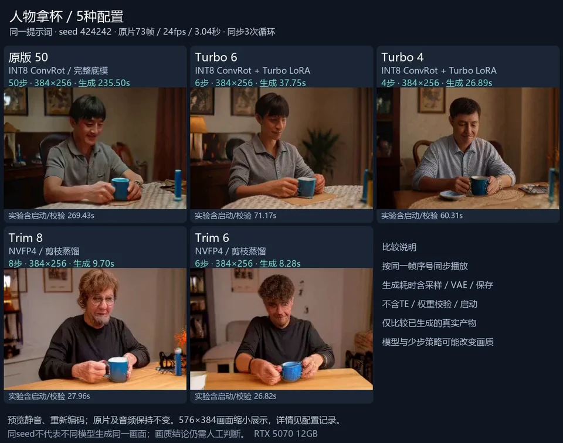

# InferRSI-MiniMax-H3

**Run a short H3-family video on an RTX 5070, and keep the configuration and timings.**

Experimental preview for an **existing ComfyUI installation**. The default is **FastH3 Trim, 8 steps, 384 × 256, 73 frames at 24 fps (~3.04 s), with audio**. Trim is a pruned/distilled H3 variant; it is not the original full H3 model and quality can differ.

中文：这是面向 RTX 5070 的 H3 运行与实验工具。首版只提供一个配置：连接已有 ComfyUI，输入提示词，生成约 3 秒视频并保存耗时。请先看下面的准备与运行步骤。

## See the output — RTX 5070 12GB

**Same prompt, same seed, five model/step settings.** These are real generated outputs from our recorded local runs.

[](https://github.com/congw729/InferRSI-MiniMax-H3/raw/refs/heads/main/docs/assets/showcase/hands-face-mug-comparison.mp4)

[Download the full-size comparison MP4](https://github.com/congw729/InferRSI-MiniMax-H3/raw/refs/heads/main/docs/assets/showcase/hands-face-mug-comparison.mp4) · [Still image](docs/assets/showcase/hands-face-mug-poster.png) · [All three examples and exact configurations](docs/SHOWCASE.md)

The comparison is **silent** and repeats each **3.04-second source clip three times**; it is not a 9-second generation. The animated preview is resized and encoded at about 12 fps for the README; open the full-size, 24 fps MP4 to inspect the outputs.

| Model / adaptation | Steps | Sampler | Generation request (s) | Experiment total (s) |
| --- | ---: | --- | ---: | ---: |
| Original H3 INT8 ConvRot | 50 | `euler` | 235.497 | 269.434 |
| Original H3 + Turbo v4 EMA | 6 | `euler` | 37.749 | 71.174 |
| Original H3 + Turbo v4 EMA | 4 | `euler` | 26.886 | 60.315 |
| FastH3 Trim NVFP4 (default) | 8 | `res_multistep` | 9.702 | 27.965 |
| Same Trim 8-step checkpoint | 6 | `res_multistep` | 8.283 | 26.825 |

**Test conditions:** Windows, RTX 5070 12GB / 32GB RAM, ComfyUI v0.43.0; seed `424242`, 384 × 256, 73 frames at 24 fps. Each row is one historical run with a fresh service and **reused, precomputed text conditioning**. Weight verification pre-read model files; these are not cold-file-cache measurements.

**Timing:** generation request = ComfyUI graph execution through sampling, audio/video decode and saving. Experiment total additionally includes asset checks, service startup and cleanup. **Both exclude the separate text-encoding request; do not add the columns.** Historical runs used synchronous offload; the current quick-start launch flags differ. These are observed configuration tradeoffs, not a fixed speed promise or proof of equal quality. Full quality/performance acceptance remains `INCONCLUSIVE`.

Original = unpruned H3 FL2VA with INT8 ConvRot weights. Turbo adds **v4 step600 EMA LoRA**, strength 1.0. Trim uses the **FastH3 Trim 8-step NVFP4 checkpoint**, a pruned/distilled model; the 6-step row changes its sampling steps. All five use the original INT8 video VAE. [Pinned model revisions, hashes, prompt and stage timings](docs/SHOWCASE.md).

中文：上图为同一提示词的真实成片对比；耗时复用了已编码文本条件，不包含完整首次文生视频流程。原版、Turbo 和 Trim 的模型与画质存在差异。

**More examples:** [Tennis ball — 6 configurations](docs/SHOWCASE.md#tennis-ball) · [Toy car — 11 configurations](docs/SHOWCASE.md#toy-car) · [Try the default Trim 8-step preset](#quick-start--windows-portable-comfyui)

## What you need

- A dedicated, idle **ComfyUI v0.43.0** instance with native H3 nodes; no custom nodes are needed for this preset.
- Target machine: **RTX 5070 12GB / 32GB system RAM**. Close memory-heavy applications before the first run; the launcher checks resource headroom.
- The four model files listed in [MODELS.md](quickstart/MODELS.md), about **28.87 GiB** in total. Model licenses are separate from this project's code license. Download them from their official sources and place them in the listed ComfyUI model folders.
- Python 3.10+ for the small client script (standard library only). ComfyUI's portable Python can also run it.

This repository does not download models or install/change drivers. The experimental vLLM-Omni adapter and historical experiments are documented separately below.

## Quick start — Windows portable ComfyUI

Get the client once:

```powershell
git clone https://github.com/congw729/InferRSI-MiniMax-H3.git
```

**1. Start a dedicated ComfyUI instance.** From the ComfyUI portable folder, run:

```powershell
.\python_embeded\python.exe -s ComfyUI\main.py --listen 127.0.0.1 --port 8188 --disable-auto-launch --disable-all-custom-nodes --disable-partner-nodes --offline --disable-assets --disable-pinned-memory --disable-smart-memory --cache-none --preview-method none --vram-headroom 1.0 --reserve-vram 3.0
```

Keep this terminal open. Wait for the server to be ready. Use this instance only for this client while generating: it releases loaded models between text encoding and video generation to fit the memory budget. The recorded runtime and version details are in [MODELS.md](quickstart/MODELS.md).

**2. Check the environment.** In another terminal, from this repository:

```powershell
python quickstart/run_h3.py doctor --comfy-root "<path-to-ComfyUI>"
```

Replace `<path-to-ComfyUI>` with the folder containing `main.py`, not the outer portable folder. If `python` is not available, use the full path to ComfyUI's `python_embeded/python.exe` instead. The default server address is `http://127.0.0.1:8188`.

**3. Generate a video.**

```powershell
python quickstart/run_h3.py generate --comfy-root "<path-to-ComfyUI>" --prompt "A red toy car rolls slowly across a wooden table. Static camera, continuous shot. Audio: quiet room ambience." --output "./outputs/demo.mp4"
```

Use `--help` for the supported options. Choose a new MP4 filename for each run; existing files are preserved. ComfyUI stores its intermediate files under a unique run directory. The result includes an MP4 and a small record of the prompt, seed, configuration and observed elapsed times. Text encoding and video-stage wall times are reported separately from total client time; server startup and prior model downloads are outside that total.

The preview has a [recorded functional smoke](quickstart/SMOKE-TEST.json): one new prompt produced 73 decoded video frames and an audio stream, with model cleanup and owned-service teardown checked. This is not a quality benchmark.

The first request can be slower due to model loading and kernel initialization. This preview does not promise a fixed speed or original-model quality.

## Troubleshooting

- **Cannot connect:** start ComfyUI first, check its terminal, and match the client's `--url` to the server port.
- **Missing node or model:** use the documented ComfyUI version and [model filenames/folders](quickstart/MODELS.md); check `doctor` before generating.
- **Not enough memory:** close unnecessary GPU/RAM-heavy applications and retry. The client does not terminate other applications.
- **A failed or cancelled request:** inspect the run record and ComfyUI terminal. Keep the diagnostic output; do not submit multiple jobs to the same instance while a request is still stopping.
- **Custom model/output locations:** create a custom ComfyUI output directory before starting the server; see `--help` for the explicit path options. The client and ComfyUI must refer to the same local installation and output folders.

## Project scope

- `quickstart/`: the maintained minimal ComfyUI preview.
- `src/h3_omni_adapter/`: experimental vLLM-Omni loading/streaming adapters. The quick start does not use this backend; full vLLM-Omni serving integration is a separate research goal.
- `experiments/` and `archive/`: preserved development history, including failed attempts and frozen identities. These are not additional user-facing launchers and may reference external evidence that is not bundled.
- [Adapter research notes](docs/ADAPTER-RESEARCH.md) and [source attribution](docs/provenance.md).

InferRSI organizes the research comparisons and evidence. The quick-start client does not require installing InferRSI. Future benchmark results must distinguish model changes, cache conditions and complete output workloads; a working demo is not a formal quality or performance acceptance result.

## License

Original project code is licensed under [Apache-2.0](LICENSE). ComfyUI, other dependencies and model weights retain their own licenses; see [THIRD_PARTY_NOTICES.md](THIRD_PARTY_NOTICES.md). No model weights are distributed here.
