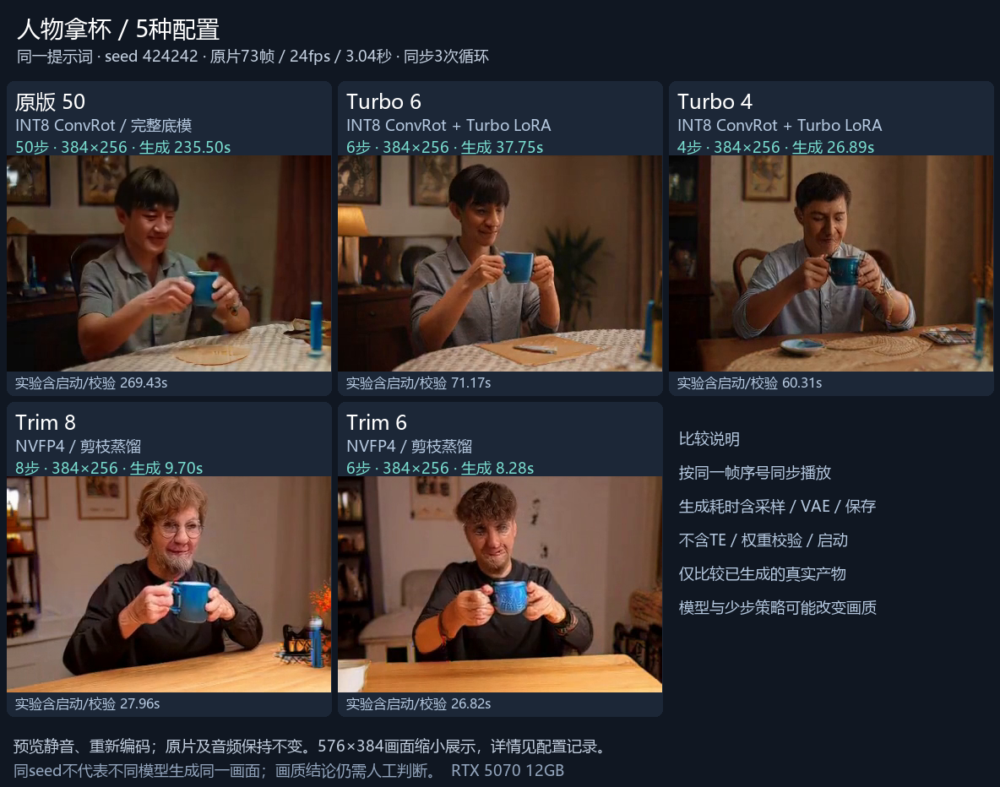
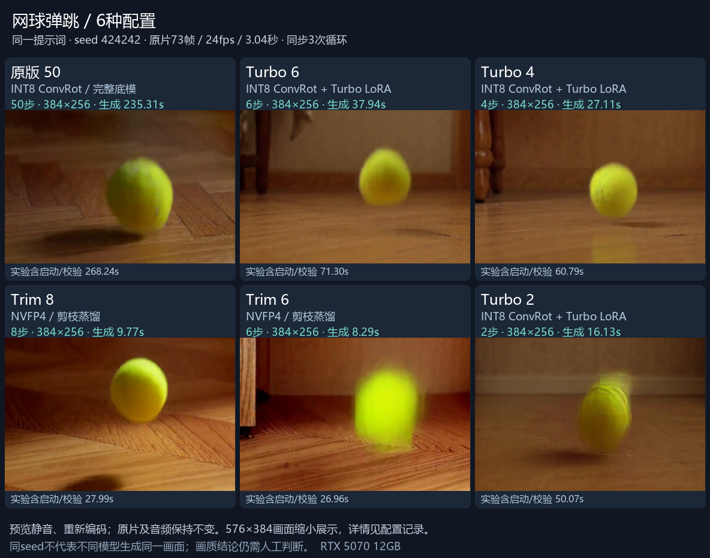
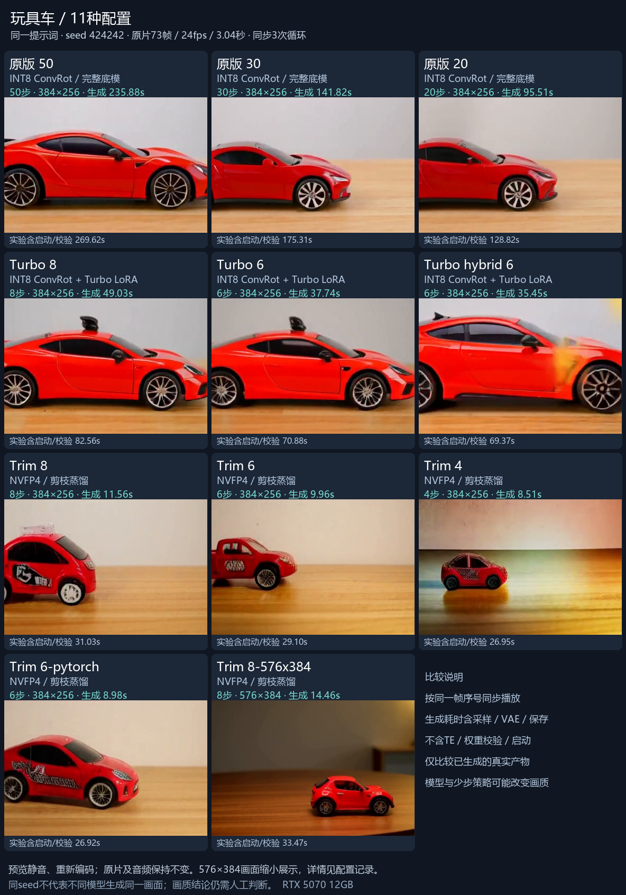

# Recorded video comparisons

These are historical local experiments from 2026-10-31, republished on 2026-11-09. The existing comparison videos were reused; no model was rerun for this page. The maintained launcher currently exposes the Trim 8-step preset only. The other rows illustrate research configurations, not extra quick-start options.

## Reading the timings

- **Generation request:** native ComfyUI history from execution_start to execution_success; includes graph execution, sampling, video/audio decoding and output writing.
- **Experiment total:** the enclosing controller, including model-file verification, startup, generation and cleanup. It excludes the separate text encoder request, as does the generation-request column. The columns overlap and must not be added.
- **Sampling node:** receiver-observed WebSocket wall interval, including event delivery and any work within the node; not a GPU-kernel timer.
- Values below are single representative observations, not medians. Fresh services do not imply a cold OS file cache: SHA verification pre-reads weights. Precomputed text conditioning is reused. No text-encoder time has been invented for these rows.
- RTX 5070 12GB / 32GB RAM, Windows; ComfyUI v0.43.0 (`426f5eea52a7ece1dd599fff4cb6cd1f352ddd24`), Python 3.13.14, PyTorch 2.14.1+cu130, comfy-kitchen 0.2.40.
- The five mug rows use synchronous offload, `--disable-smart-memory --disable-pinned-memory --cache-none --vram-headroom 1.0 --reserve-vram 3.0`. They explicitly used `--disable-async-offload`; the current quickstart omits that option. Do not interpret these historical rows as current launcher latency.
- Seed 424242, 73 frames at 24 fps. All sources are 384×256 except the explicitly marked 576×384 toy-car run. Original clips have audio; composite previews are silent and repeat the clip three times (9.125 s). Composite panels are synchronized by source frame number, without motion interpolation.
- Original H3, Turbo and Trim change model weights and/or sampling. Same seed does not imply the same visual composition. Quality and end-to-end service-performance acceptance remain **INCONCLUSIVE**; no same-quality speedup is claimed.

## Model identities

| Component | Exact export | Source revision |
| --- | --- | --- |
| trim-dit | `fastvideo_fasth3_trim_8step_nvfp4.safetensors` | [FastVideo/FastVideo-FastH3-Trim-Comfy@f66c13dc17](https://huggingface.co/FastVideo/FastVideo-FastH3-Trim-Comfy/tree/f66c13dc17391dd4da99242a407918b92bf7d5fc) |
| text-encoder | `qwen3vl_32b_minimax_h3_nvfp4_awq.safetensors` | [Comfy-Org/MiniMax-H3@e5eb578a89](https://huggingface.co/Comfy-Org/MiniMax-H3/tree/e5eb578a89295337b8ff433a035929ce0279e0b6) |
| video-vae | `minimax_h3_video_vae_int8_convrot.safetensors` | [Comfy-Org/MiniMax-H3@e5eb578a89](https://huggingface.co/Comfy-Org/MiniMax-H3/tree/e5eb578a89295337b8ff433a035929ce0279e0b6) |
| audio-vae | `minimax_h3_audio_vae_fp32.safetensors` | [Comfy-Org/MiniMax-H3@e5eb578a89](https://huggingface.co/Comfy-Org/MiniMax-H3/tree/e5eb578a89295337b8ff433a035929ce0279e0b6) |
| original-dit | `minimax_h3_fl2va_int8_convrot.safetensors` | [Comfy-Org/MiniMax-H3@e5eb578a89](https://huggingface.co/Comfy-Org/MiniMax-H3/tree/e5eb578a89295337b8ff433a035929ce0279e0b6) |
| turbo-lora | `minimax_h3_turbo_v4_step600_ema.safetensors` | [larryvrh/MiniMax-H3-Turbo-Lora@7b7ac96b06](https://huggingface.co/larryvrh/MiniMax-H3-Turbo-Lora/tree/7b7ac96b0616100db75ea285090210c3ddf37c04) |

Full SHA256 identities are in [showcase-data.json](showcase-data.json). Turbo uses v4 step600 EMA at strength 1.0; original/Turbo use Euler with video/audio sigma shifts 12/3. Trim uses res_multistep with shifts 10/3 and the native configured VSA path; selecting that path does not prove sparse attention was activated for this short geometry. All groups use the original INT8 ConvRot video VAE and FP32 audio VAE; text conditions come from the Qwen3-VL-32B NVFP4 AWQ export. Trim 6/4 alter the step count of the same 8-step checkpoint.

## Person lifting a mug

> An adult sitting at a table slowly lifts a blue ceramic mug with both hands and gives a small smile. Static waist-up camera, continuous shot. Audio: a light ceramic sound as the mug leaves the table and a quiet room, no speech.

[Play / download MP4](assets/showcase/hands-face-mug-comparison.mp4)

| Profile | Steps | Sampling node (s) | Generation request (s) | Experiment total (s) |
| --- | ---: | ---: | ---: | ---: |
| `original-50` | 50 | 232.658 | 235.497 | 269.434 |
| `turbo-native-6` | 6 | 35.069 | 37.749 | 71.174 |
| `turbo-native-4` | 4 | 24.204 | 26.886 | 60.315 |
| `trim-8` | 8 | 7.458 | 9.702 | 27.965 |
| `trim-6` | 6 | 6.142 | 8.283 | 26.825 |

## Tennis ball

> A single yellow tennis ball drops onto a wooden floor, bounces twice, and settles. Static camera, continuous shot. Audio: two soft impacts matching the visible bounces, with a quiet room background.

[Play / download MP4](assets/showcase/bounce-audio-comparison.mp4)

| Profile | Steps | Original dimensions | Generation request (s) | Experiment total (s) |
| --- | ---: | --- | ---: | ---: |
| `original-50` | 50 | 384×256 | 235.307 | 268.243 |
| `turbo-native-6` | 6 | 384×256 | 37.939 | 71.297 |
| `turbo-native-4` | 4 | 384×256 | 27.106 | 60.786 |
| `trim-8` | 8 | 384×256 | 9.769 | 27.992 |
| `trim-6` | 6 | 384×256 | 8.295 | 26.964 |
| `turbo-native-2` | 2 | 384×256 | 16.131 | 50.068 |

## Toy car

> A small red toy car drives slowly from left to right across a wooden table. Static camera, continuous motion. Audio: a quiet motor hum.

[Exact source text-encoding graph](../experiments/comfyui/rtx5070-12gb/2026-10-31-speed-quality-search/agents/quality-corpus/CANONICAL-STAGE-A-v1.json).

[Play / download MP4](assets/showcase/toycar-comparison.mp4)

| Profile | Steps | Original dimensions | Generation request (s) | Experiment total (s) |
| --- | ---: | --- | ---: | ---: |
| `original-50` | 50 | 384×256 | 235.875 | 269.621 |
| `original-30` | 30 | 384×256 | 141.823 | 175.308 |
| `original-20` | 20 | 384×256 | 95.507 | 128.816 |
| `turbo-native-8` | 8 | 384×256 | 49.031 | 82.556 |
| `turbo-native-6` | 6 | 384×256 | 37.737 | 70.882 |
| `turbo-hybrid-6` | 6 | 384×256 | 35.450 | 69.370 |
| `trim-8` | 8 | 384×256 | 11.563 | 31.031 |
| `trim-6` | 6 | 384×256 | 9.957 | 29.099 |
| `trim-4` | 4 | 384×256 | 8.506 | 26.946 |
| `trim-6-pytorch` | 6 | 384×256 | 8.984 | 26.916 |
| `trim-8-576x384` | 8 | 576×384 | 14.462 | 33.474 |

The toy-car `turbo-hybrid` row is an exploratory custom Turbo LoRA-loading variant (Euler, 6 steps); `trim-6-pytorch` changes the attention backend. Selected loader, attention and scheduler settings are retained in the JSON; the [hybrid loading plan](../experiments/comfyui/rtx5070-12gb/2026-10-31-speed-quality-search/agents/turbo-hybrid-controller/PLAN-FROZEN-v1.json) records the custom LoRA application strategy separately. The generic Chinese footer about downscaling a 576×384 image applies only to that toy-car tile; every mug and ball source is 384×256.

## Evidence and media provenance

- [Machine-readable comparison data, source output hashes and model identities](showcase-data.json).
- [Archived run summary, including failed attempts and other configurations](../experiments/comfyui/rtx5070-12gb/2026-10-31-speed-quality-search/results/Q33-READONLY-SUMMARY-v8.json).
- [Research report and limitations](../experiments/comfyui/rtx5070-12gb/2026-10-31-speed-quality-search/REPORT.zh-CN.txt).
- [Prompt corpus and frozen provenance](../experiments/comfyui/rtx5070-12gb/2026-10-31-speed-quality-search/agents/quality-corpus/CORPUS-MANIFEST-v1.json).
- MP4/PNG composites are byte-identical copies of the previously reviewed comparison artifacts. The README animated WebP is a resized, frame-sampled derivative for display; it is not suitable for pixel-level or audio-quality comparison. Original videos and historical evidence were not modified.
- Demonstration media is AI-generated, including the depicted people. Names identify models and compatibility, not endorsement. [Model terms and third-party notices](../THIRD_PARTY_NOTICES.md) remain applicable.
